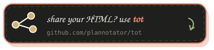

<p align="center">
  
</p>

# Effective HTML

[English](README.md) | [简体中文](README.zh.md)

ローフィデリティのワイヤーフレームから動作するインタラクティブなプロトタイプまで、役に立つ自己完結型の HTML 成果物を作成するための、目的を絞ったエージェントスキルです。

## 厚い成果物 + 厚いコンテキスト

最近のモデルは多くのことができます。役に立つ参考資料をたっぷり与え、
成果物を使って意図を示しましょう。HTML はほとんど何でも可視化でき、多くの場合、
長々としたテキストよりもわかりやすく伝えられます。プロンプトでは、コンテキストを担う成果物、
リポジトリ、フォルダーを指し示すだけで済みます。

> [!NOTE]
> このリポジトリは、何もインストールせずに使えます。まずは参考資料として、
> 次にインストール可能なスキルのコレクションとして扱ってください。
> [Effective HTML のガイド](https://www.effectivehtml.com/)をご覧ください。

https://github.com/user-attachments/assets/24306977-7f30-44c9-9bff-55f901d557b0

<p align="center">
  <a href="https://github.com/backnotprop/plannotator">
    
  </a>
</p>
<p align="center">
<a href="https://github.com/backnotprop/plannotator">Plannotator</a> で、ローカルの HTML を表示して注釈を付けられます。
</p>

## スキルのリファレンス

このリポジトリには、実用的なビジュアル成果物のための 8 つのオプションのスキルが含まれています。

| スキル | 用途 |
| --- | --- |
| [`html`](skills/html/SKILL.md) | 幅広い HTML のリクエスト、複合的な成果物、レポート、解説、プレゼンテーション、ランディングページ、ツール、そして専門スキルへの振り分け |
| [`big-pics-little-words`](skills/big-pics-little-words/SKILL.md) | 重要な詳細を保ちながら、大きなビジュアルと最小限のテキストで、現在の主題を HTML で説明します。[bro](https://github.com/backnotprop/bro/blob/main/skills/big-pics-little-words/SKILL.md) からコピーしたものです |
| [`one-pager`](skills/one-pager/SKILL.md) | ワンページャーを作成します：早い段階でチームメイトにアイデアを共有したり、作業をまとめて伝えたりするための、大きな絵と少ない言葉による 1 枚の HTML ページです。[bro](https://github.com/backnotprop/bro/blob/main/skills/one-pager/SKILL.md) からコピーしたものです |
| [`design-artifact`](skills/design-artifact/SKILL.md) | 再利用可能なハウススタイルを押し付けることなく、あらゆる HTML 成果物に主題に応じたクリエイティブディレクションを与えます |
| [`html-wireframe`](skills/html-wireframe/SKILL.md) | コンテンツ、階層、ナビゲーション、フロー、レスポンシブな構造を検証する、ローフィデリティのレイアウトの方向性 |
| [`html-prototype`](skills/html-prototype/SKILL.md) | 現実的な状態、インタラクション、キーボード操作への対応、レスポンシブな動作を備えた、動作するプロトタイプ |
| [`html-plan`](skills/html-plan/SKILL.md) | 元の約束事を保持した計画、ロードマップ、ロールアウト、実装の手順 |
| [`html-diagram`](skills/html-diagram/SKILL.md) | アーキテクチャ、シーケンス、プロセス、状態、階層、タイムライン、システムのダイアグラム |

実践ガイド：[HTML Wireframes and Prototypes for Coding Agents](https://docs.plannotator.ai/learn/code-context/html-wireframes-and-prototypes-for-coding-agents)。

## インストール

これらのリファレンスを再利用可能なワークフローとしてエージェントで使えるようにしたい場合は、
コレクションをインストールしてください：

```bash
npx skills add plannotator/effective-html
```

個別のスキルを一覧表示したり、インストールしたりするには：

```bash
npx skills add plannotator/effective-html --list
npx skills add plannotator/effective-html --skill big-pics-little-words
npx skills add plannotator/effective-html --skill one-pager
npx skills add plannotator/effective-html --skill design-artifact
npx skills add plannotator/effective-html --skill html-wireframe
npx skills add plannotator/effective-html --skill html-prototype
```

### Claude Code プラグイン

```text
/plugin marketplace add plannotator/effective-html
/plugin install plannotator-effective-html@effective-html
```

### Codex プラグイン

```bash
codex plugin marketplace add plannotator/effective-html
codex plugin add plannotator-effective-html@effective-html
```

## スキルの仕組み

これらのスキルは、クリエイティブな自由と信頼性を切り分けています：

- ビジュアルの方向性は、会話、プロジェクト、オーディエンス、主題から決まります。
- `design-artifact` は、再利用可能な見た目を規定することなく、再利用可能なデザインのプロセスを提供します。
- ワイヤーフレームは、レビュアーが構造に集中できるよう、意図的に未完成のままにします。
- プロトタイプは、信頼できる 1 つのフローと、それに関連する状態を実装します。
- 計画は、元の約束事を保持します。
- ダイアグラムは、説明する関係に合ったビジュアルのモデルとレンダリングの方法を選びます。
- すべての成果物は、レスポンシブで、アクセシブルで、自己完結しており、ブラウザで検証されています。

詳細なガイダンスは、必要な場所にだけ置かれています。幅広い `html` スキルが作業を振り分け、`design-artifact` がオプションのクリエイティブディレクションを提供し、専門スキルが忠実度と動作を担います。各スキルは単独でも使えます。

このプロジェクトは、Thariq Shihipar の [The unreasonable effectiveness of HTML](https://thariqs.github.io/html-effectiveness) に着想を得ています。

<p align="center">
  <a href="https://github.com/plannotator/tot">
    
  </a>
</p>
<p align="center">
<a href="https://github.com/plannotator/tot">tot</a> で、HTML ファイルの共有リンクを作成できます。
</p>
